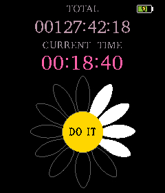

# Work timer — ESP32-S3-Touch-LCD-1.69

Часовой таймер для [Waveshare ESP32-S3-Touch-LCD-1.69](https://www.waveshare.com/esp32-s3-touch-lcd-1.69.htm). Прошивка на ESP-IDF. Экран ST7789, 240×280.



Ромашка — это текущий час. Двенадцать лепестков, каждый по пять минут. Заполнение идёт от 12 часов по часовой стрелке. На границе часа ромашка очищается и заполняется снова. В центре жёлтого круга состояние: `DO IT`, пока таймер идёт, и `PAUSE`, пока стоит.

Сверху две строки. `TOTAL` — общая наработка за всё время, формат `ЧЧЧЧЧ:ММ:СС`, до 10000 часов. `CURRENT TIME` — текущий сеанс, формат `ЧЧ:ММ:СС`. Сеанс не обрывается на часе: цифры идут дальше, а ромашка начинает круг заново. Оба значения пишутся во flash и не пропадают после перезагрузки.

Справа сверху значок батареи. Заливка показывает заряд, жёлтая молния — что зарядка подключена.

## Жесты

- **Тап** — старт или пауза, с коротким тихим сигналом.
- **Двойной тап** — сброс текущего сеанса. Общая наработка при этом остаётся.

Пока таймер на паузе, время в `TOTAL` не растёт. Сам на часе он не останавливается. Если выключить питание во время хода, потеряется не больше 15 секунд — счётчик сохраняется с таким шагом.

Кнопка питания гасит и включает экран. Выключенный экран уходит в лёгкий сон. Остановленный таймер спит до следующего нажатия. Идущий продолжает считать и просыпается только чтобы сохранить наработку.

Чтобы обнулить наработку и сеанс: `idf.py erase-flash`, затем прошить заново.

## Сборка

Нужен ESP-IDF 5.3.1 или новее и цель ESP32-S3. Плата: 16 МБ flash, 8 МБ octal PSRAM, прошивка и лог через USB-C.

```bash
idf.py set-target esp32s3
idf.py build
idf.py -p COM5 flash monitor
```

`COM5` замените на порт USB Serial/JTAG этой платы. Если загрузчик не находится, зажмите BOOT, нажмите RESET и отпустите BOOT.

Если цвета на экране перепутаны, в `main/main.c` поменяйте `LCD_SWAP_BYTES` на `0`.
